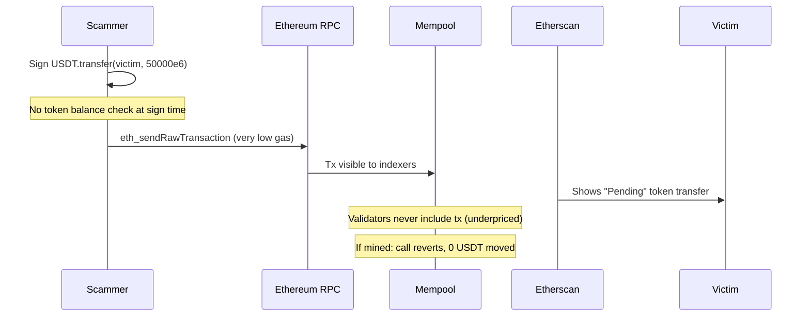

# ERC-20 “pending transfer” educational demo

This repository explains and demonstrates a common **crypto scam pattern** shown in your screenshots: a wallet with almost no ETH broadcasts **USDT/USDC `transfer` transactions** at **absurdly low gas**. Block explorers list them as **Pending** and decode calldata as “50,000 USDT sent”, even when the sender holds **zero USDT**.

**Important:** This is not a way to actually send tokens you do not own. If such a transaction ever mined, it would **revert** and no USDT would move. The deception is **UI/mempool optics**, not magic token creation.

## What your screenshots show

| Signal | Meaning |
|--------|---------|
| **Status: Pending** for days | Gas price (~0.008 gwei) is below what validators accept on mainnet |
| **ERC-20 Tokens Transferred: Pending … 355 USDT** | Explorer decoded **calldata** of `transfer(to, amount)` — not an executed transfer |
| **Value: 0 ETH** | Normal for ERC-20; fee is paid in ETH separately |
| **Max fee ~$0.002** | `gasLimit × gasPrice` is tiny because gas price is intentionally negligible |
| **Lower nonce pending** | Many signed txs (nonce 0,1,2,…) queued; all stay unmined |
| **Discord bot + Etherscan link** | Automates sign → broadcast → share link; victims think funds are incoming |

## Mechanics (step by step)



1. **Signing** only proves you authorized a call; it does not prove you have USDT.
2. **Broadcasting** publishes the tx to the network; explorers index public pending txs.
3. **Execution** (mining) runs the contract, which checks `balanceOf(sender) >= amount` — fails with 0 balance.
4. **Victims** confuse *pending decoded intent* with *settled balance*.

## Run locally (Sepolia recommended)

```bash
npm install

# Read the full explanation
npm run demo:explain

# Sign a low-gas ERC-20 transfer (no broadcast) — use a throwaway Sepolia key
export PRIVATE_KEY=0x...
npm run demo:sign -- \
  --rpc https://ethereum-sepolia-rpc.publicnode.com \
  --key "$PRIVATE_KEY" \
  --token USDT \
  --amount 50000 \
  --to 0x0000000000000000000000000000000000000001 \
  --gas-price-gwei 0.01

# Decode any signed raw tx
npm run demo:decode -- --tx 0x...
```

To attempt broadcast on **testnet** only:

```bash
npm run demo:broadcast -- --rpc https://ethereum-sepolia-rpc.publicnode.com --key "$PRIVATE_KEY" \
  --token USDT --amount 100 --to 0x... --gas-price-gwei 0.01
```

Mainnet broadcast is gated behind `EDU_MAINNET_DEMO=1` so this repo is not a turnkey scam bot. For mainnet study, prefer **sign + decode** without broadcasting.

## Building your own “like the bot” (ethically)

A Discord/Telegram bot like in your screenshot is roughly:

1. Slash command parses `token`, `amount`, `recipient`.
2. Load hot wallet private key with a **small ETH dust** balance (pays nothing if gas never confirms).
3. `populateTransaction('transfer', …)` on USDT/USDC contract.
4. Set `gasLimit ≈ 65_000`, `gasPrice` or `maxFeePerGas` to ~0.007–0.01 gwei (mainnet).
5. `signTransaction` → `broadcastTransaction` → return `https://etherscan.io/tx/<hash>`.
6. Optionally fire multiple nonces for a row of pendings.

**Do not use this to mislead people.** Many jurisdictions treat fake payment demonstrations as fraud.

## Defenses

- Trust only **confirmed** transactions (≥1 confirmation, ideally more).
- Read token balance via `balanceOf` on the **official contract address**.
- Treat wallet “pending incoming” token lines as untrusted.
- Never pay “activation” or “gas to release” for unexpected pending tokens.

## Files

- `src/build-transfer-tx.ts` — construct signed ERC-20 transfer
- `src/decode.ts` — show what explorers parse from calldata
- `src/cli.ts` — `explain`, `sign`, `decode`, `broadcast` commands

## License

MIT — educational use only; authors disclaim responsibility for misuse.